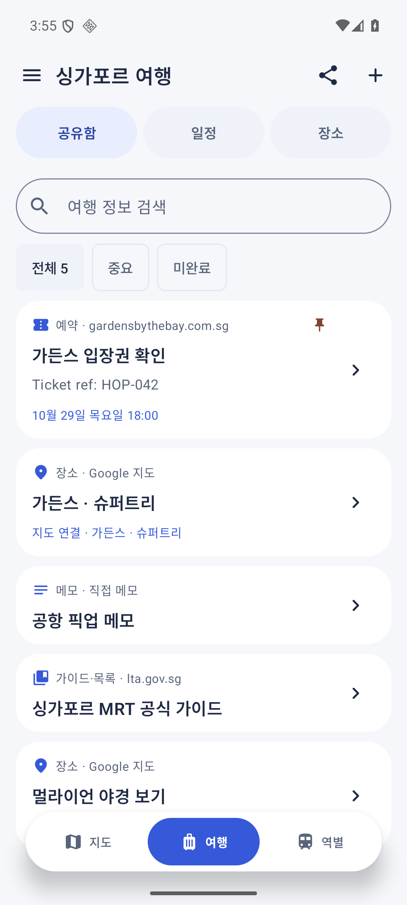
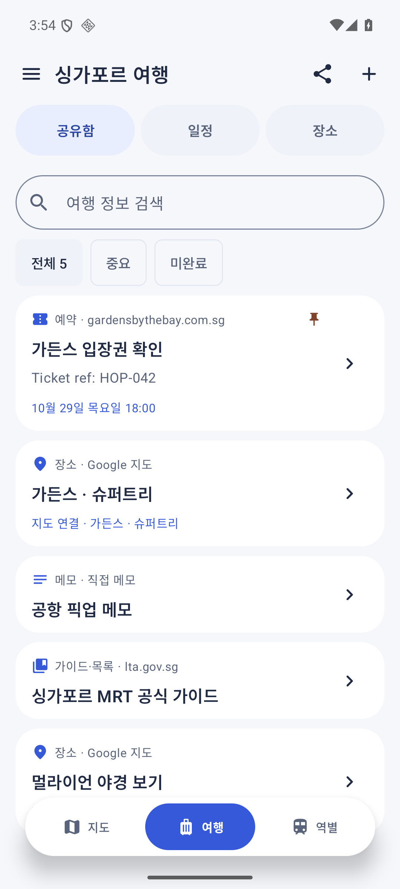
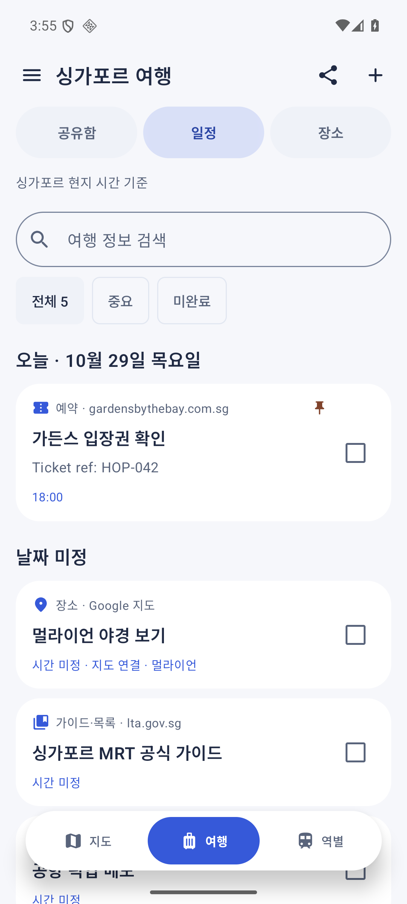

# hop — 싱가포르 MRT 여행 앱

Kotlin + Jetpack Compose로 구현한 싱가포르 여행용 Android 앱입니다. 다른 앱에서 공유한 여행 정보와 예약 링크를 바로 보관하고, 일정·메모·MRT 지도를 연결합니다. 상세 도로 지도 위에서 장소와 가까운 역을 확인할 수 있습니다. Blue Hour 테마와 컴팩트한 플로팅 메뉴를 적용했습니다. 실제 앱 소스는 `app/`입니다.

## 설치와 실행

- **Obtainium 소스 URL:** https://github.com/jonghyunseo/hop-singapore
- Obtainium → 앱 추가 → 위 URL 입력 → 추가 → 설치. 이후 GitHub Release의 새 버전을 확인할 수 있습니다.
- **[최신 APK 다운로드](https://github.com/jonghyunseo/hop-singapore/releases/latest)** · Android 8.0(API 26) 이상.
- 앱 패키지 `app.hop.singapore`. APK는 기종별 선택이 필요 없는 단일 파일입니다.
- Android Studio에서 이 폴더를 열고 `app` 실행 구성을 선택해도 됩니다.
- 첫 실행은 싱가포르 예시 여행지 6곳으로 시작합니다. 자유롭게 수정·삭제할 수 있습니다.
- 전용 키로 서명한 release APK입니다. 스토어 배포·사용자 계정·클라우드 동기화는 포함하지 않습니다.

이전 `0.1.0-debug` APK와는 서명이 다릅니다. 개발판이 설치되어 있다면 보관할 장소·메모를 먼저 확인한 뒤 삭제하고 배포판을 설치하세요. 삭제 시 개발판의 로컬 데이터도 삭제됩니다. `0.1.1` 이후 배포판은 같은 서명 키로 업데이트합니다.

<p>  </p>

## 공유로 여행 정보 모으기

**Google 지도·브라우저·예약 앱 → 공유 → hop**. 제목과 텍스트/링크를 즉시 기기에 저장합니다. 좌표 입력이나 네트워크 요청을 기다릴 필요가 없습니다.

- Google 지도 **목록 링크도 그대로 보관**하고 ‘원문 보기’로 엽니다. 목록 전체를 hop 지도 핀으로 변환하는 기능은 아닙니다.
- 원문은 앱에서 연 브라우저 탭(Custom Tabs)으로 확인합니다. 원본 서비스의 로그인/인터넷이 필요할 수 있으며 일부 링크는 해당 앱으로 이동합니다.
- ‘일정·메모’에서 날짜·시간, 예약번호, 준비할 것을 기록합니다. 일정은 **싱가포르 현지 시간** 기준입니다.
- 중요한 예약·링크를 위에 고정하고, 검색하거나 완료 체크합니다. 같은 링크를 다시 공유해도 기존 일정·메모를 유지합니다.
- ‘장소 연결’에서 기존 저장 장소를 선택하거나 새 장소를 추가해 MRT 지도로 이어집니다. 저장한 장소의 옵션 → ‘여행 일정에 추가’도 가능합니다.
- 하단 **여행 → 공유함 / 일정 / 장소**. 기존 저장 장소는 ‘장소’에 유지됩니다.
- 링크를 복사한 경우 **+ → 링크·메모 보관 → 붙여넣기**로 추가할 수 있습니다. 원문 텍스트·메모·일정은 오프라인에서 볼 수 있습니다.
- 단일 싱가포르 여행 보관함입니다. 이미지/PDF 첨부·OCR·이메일 자동 수집·계정 동기화·동행자 실시간 협업은 포함하지 않습니다.

벤치마크와 화면/데이터 설계: [공유 중심 여행 시스템](docs/travel-system-v0.4.md).

## 구현한 핵심 기능

- **상세 지도를 기본으로 표시**: MapLibre Native + OpenStreetMap 도로·건물·상점 지도 위에 6개 MRT 노선, 142개 역과 저장 장소 표시.
- 드래그·핀치·두 번 탭 확대·회전·북쪽 정렬·확대/축소 버튼·축척·저장 장소 전체 보기.
- 저장 장소·MRT 역을 오프라인 검색. 장소 이름·주소·우편번호는 온라인 검색, 최근 검색 8개 보관.
- 음식점·카페·관광지·쇼핑몰·숙소: 지도 중심 2.5km 안의 검색 결과 최대 20곳을 지도와 거리순 목록으로 표시.
- 지도 탭·길게 누르기로 좌표와 주변 주소 확인, 장소 저장. 역 선택 시 지도 안에서 역 정보 표시.
- 상세 지도·MRT·저장 장소 레이어 각각 켜기/끄기, 연결 상태·재시도 안내.
- Haversine 직선거리 기반 최근접 3개 역 비교. 장소와 역을 잇는 직선 표시.
- 현재 위치 또는 가까운 역에서 도보·대중교통·자동차 길찾기를 Google 지도로 열기. 장소 링크 공유와 외부 장소 정보 열기.
- 역별 400m / 800m / 1.2km 반경 안의 저장 장소를 거리순으로 표시.
- 장소 저장·수정·메모·방문 체크·검색·방문 필터·삭제와 실행 취소.
- 원자적 파일 저장. 앱 재실행 후 장소·방문 상태·메모와 선택 설정 복원.
- Android `ACTION_SEND` 텍스트/링크 공유 즉시 보관. Google Maps 장소 링크는 필요할 때 지도에 연결. 장소명 검색·좌표 입력·지도 핀도 지원.
- 공유 원문은 위치와 무관하게 저장하며, 지도 연결 시 실제 위치를 확인. 링크의 지도 카메라 좌표를 장소 좌표로 오인하지 않음.
- Google Takeout ZIP/CSV와 GeoJSON 파일 가져오기. 목록 이름과 메모를 유지하고, 좌표 없는 항목은 검색·핀으로 보완. 선택 저장, 중복 제외, 미확인 항목 유지.
- 화면 끝까지 채우는 지도. 하차역 카드는 작게 표시하고 3개 역 비교는 펼쳐서 확인.
- 라이트·다크·시스템 테마. 측정한 메뉴 높이에 따라 하단 여백을 확보하는 플로팅 메뉴.
- 내 위치 버튼에서 권한 요청 후 위치 표시·추적. 지도를 움직이면 추적을 중지하며, 앱이 보이지 않으면 위치 업데이트를 중단.

## 지도와 온라인 기능

상세 지도를 처음부터 켜서 도로명·건물·상점·랜드마크를 표시합니다. 이전 버전의 기본 꺼짐 설정도 이번 업데이트에서 켜짐으로 바꿉니다. 레이어 메뉴에서 직접 끄는 선택은 이후 유지합니다. MapLibre Native 13.7.1이 OpenStreetMap 래스터 타일을 표시하며 API 키 없이 실행됩니다.

화면에 필요한 타일만 요청하고 지도 확대 시 미리 가져오기는 끕니다. 서버의 캐시 헤더를 따르는 100MB 디스크 캐시를 사용하며 캐시 지시가 없으면 7일을 적용합니다. 지역 전체 다운로드는 제공하지 않습니다. 네트워크가 끊기면 캐시된 지도, 앱에 포함된 도심 간략 도로·수역·공원, MRT 전역과 저장 장소가 남습니다. 아직 받아 본 적 없는 지역의 상세 도로는 오프라인에서 표시되지 않습니다.

온라인 장소 검색과 주변 탐색은 [Photon](https://github.com/komoot/photon)을 사용합니다. 검색 버튼·카테고리·지도 위치 선택처럼 사용자가 요청한 경우만 호출하고, 1초 간격 제한과 24시간 결과 캐시를 적용합니다. 텍스트 검색 연결 실패 시 Android Geocoder로 재시도합니다. 공개 검색 서비스의 가용성과 모든 상점의 등록 여부는 보장되지 않습니다. 검색 시 검색어와 지도 중심 좌표, 핀 선택 시 좌표가 해당 서비스에 전달됩니다.

저장된 장소·역 좌표·직선거리 계산·메모는 네트워크 없이 작동합니다. 실제 도보·대중교통·자동차 경로와 안내는 **외부 Google 지도**에서 확인합니다. 앱 내부 내비게이션, 실시간 교통, 위성사진, 스트리트뷰는 포함하지 않습니다. 지도에서 표시하는 점선과 거리 수치는 실제 이동 경로가 아닌 직선입니다.

좌표가 포함된 공유 링크는 직접 해석하고 단축 링크는 허용된 Google Maps 도메인의 HTTPS 리디렉션만 따라갑니다. 좌표를 확인하지 못하면 검색 결과·좌표 입력·지도 핀으로 확인해야 합니다.

## 파일 가져오기

**메뉴 → 파일에서 가져오기 (고급)** 또는 여행 → 장소 → 파일에서 장소 가져오기. 일상적인 정보 수집에는 위의 공유 방식을 권장합니다.

1. [Google Takeout](https://takeout.google.com/)에서 **Saved(저장됨)**를 선택하고 ZIP으로 내보냅니다. [Google 공식 안내](https://support.google.com/maps/answer/7280933?hl=ko).
2. hop의 ‘다운로드한 파일 선택’에서 ZIP 또는 압축을 푼 CSV를 고릅니다. 기존 Point GeoJSON도 지원합니다.
3. 이름·메모·위치를 검토하고 선택한 장소를 가져옵니다. 좌표가 없는 항목은 ‘위치 확인’에서 검색 결과를 선택하거나 지도 핀·좌표를 지정하세요.

확인된 장소를 저장해도 나머지 항목은 검토 화면에 남습니다. 이 화면을 닫거나 앱 프로세스가 종료되면 미저장 검토 목록은 파일에서 다시 열어야 합니다. 이미 저장한 장소는 유지되며 재가져오기 시 같은 이름·15m 이내 위치의 중복을 제외합니다.

CSV/GeoJSON은 2MB, ZIP은 압축 전후 각각 20MB, 총 1,000개 항목까지 지원합니다. 사용자 선택 파일만 읽고 저장소 전체 권한은 요구하지 않습니다. ZIP은 파일 시스템에 압축 해제하지 않습니다.

CSV의 예:

```csv
Title,Note,URL
Singapore Flyer,해 질 무렵,"https://www.google.com/maps/?q=1.2894095,103.8631218"
National Gallery Singapore,오후 방문,https://www.google.com/maps/place/National+Gallery+Singapore
```

Takeout의 설명문 다음에 나오는 헤더와 `Title`, `Note`, `URL` / `item_content_url` 형식을 인식합니다. 좌표가 별도로 있는 `latitude/lat`, `longitude/lon/lng` CSV도 가능합니다. GeoJSON은 Point geometry와 `name`/`Title`/`Location.Business Name`을 읽습니다. [Google 저장 데이터 스키마](https://developers.google.com/data-portability/schema-reference/save)를 참고했습니다.

Google 계정 자동 동기화나 목록 공유 링크 전체 가져오기는 지원하지 않습니다. 계정 로그인이나 API 키 없이 파일을 가져오며, 제목만으로 추정한 위치를 자동 저장하지 않습니다. 개별 장소는 Google Maps → 공유 → hop으로도 추가할 수 있습니다.

샘플: `samples/google-saved.csv`, `samples/places.csv`, `samples/places.geojson`.

## 개발

준비된 안정 버전을 재사용해 SDK 설치·빌드 도구 교체 시간을 줄였습니다. Android SDK 36, JDK 17 이상, Gradle 8.14.3, AGP 8.13.2, Kotlin 2.2.21, Compose BOM 2025.11.01, Material 3. 특정 라이브러리의 최신 버전이라는 주장은 아닙니다.

```powershell
.\gradlew.bat :app:assembleDebug
.\gradlew.bat :app:testDebugUnitTest
```

이 Windows 환경은 시스템 경로에 잘못된 따옴표가 있어 Gradle 테스트 JVM 시작을 방해했습니다. 시스템 설정을 변경하지 않고 다음 실행 옵션으로 우회했습니다.

```powershell
.\gradlew.bat '-Djava.library.path=C:\Windows\System32' :app:testDebugUnitTest
```

핵심 흐름 검수 기록: [docs/verification.md](docs/verification.md). 반복적인 전체 테스트 대신 거리·반경·공유 좌표·호스트 검증 4개, 가져오기 3개, 길찾기 URL 2개, 여행 공유·중복·일정 3개와 실제 에뮬레이터의 핵심 흐름을 점검합니다. `scripts/smoke_android.py`는 테스트 전용 `hop_api36` 에뮬레이터의 초기 6개 장소 상태와 개발용 APK를 기준으로 실행하며 테스트 데이터를 추가합니다. 개인 기기를 대상으로 실행하지 마세요.

## 배포 업데이트

1. `app/build.gradle.kts`의 `versionCode`와 `versionName`을 함께 올립니다.
2. 같은 서명 키로 `scripts/build-release.ps1`을 실행합니다. 키와 암호는 저장소에 포함하지 않습니다.
3. 커밋과 `v버전` 태그를 올리고 GitHub Release에 `deliverables/hop-버전.apk`와 `.sha256` 파일을 첨부합니다.
4. Obtainium은 같은 저장소 URL에서 새 Release를 확인합니다.

Windows 배포 스크립트는 사용자 프로필의 `.android/hop-singapore-release`에서 키를 읽고, 현재 사용자에게 암호화된 DPAPI 비밀번호를 해독해 빌드 프로세스 환경 변수로만 전달합니다. 다른 빌드 환경에서는 `HOP_SIGNING_STORE_FILE`, `HOP_SIGNING_STORE_PASSWORD`, `HOP_SIGNING_KEY_ALIAS`, `HOP_SIGNING_KEY_PASSWORD`를 주입한 뒤 `:app:assembleRelease`를 실행할 수 있습니다. 기존 키를 잃으면 같은 앱을 정상 업데이트할 수 없으므로 키와 암호의 별도 안전한 백업이 필요합니다.

## 코드 위치

| 파일 | 역할 |
|---|---|
| `Domain.kt` | 거리·역 후보·반경·공유 좌표 해석 |
| `Data.kt` | 로컬 저장·ViewModel·온라인 검색·링크 확인 |
| `NativeMap.kt`, `MapView.kt` | MapLibre 지도·레이어·라벨·타일 캐시·카메라 범위 맞춤 |
| `PlaceSearch.kt`, `ExploreScreen.kt` | 온라인 장소 검색·주변 탐색·검색 화면·레이어·길찾기·공유 |
| `FollowLocation.kt` | 화면이 보이는 동안의 위치 추적 |
| `HopApp.kt`, `Theme.kt` | 네이티브 화면·플로팅 메뉴·테마 |
| `Imports.kt`, `ImportScreen.kt` | Google Takeout ZIP/CSV/GeoJSON 읽기·검토·위치 보완 |
| `MainActivity.kt` | Android 공유 수신·위치 요청 |
| `TravelDomain.kt`, `TravelData.kt` | 여행 정보·원문·일정·중복 처리·원자적 로컬 저장 |
| `TravelScreen.kt` | 공유함·날짜별 일정·원문 보기·편집·장소 연결 |

원본 데이터와 사용 조건은 `THIRD_PARTY_NOTICES.md`를 참고하세요. 실시간 열차·운임·출구별 접근성·여행 순서 최적화·여러 여행·계정 동기화는 후속 범위입니다.
