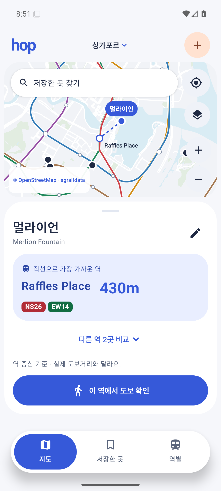
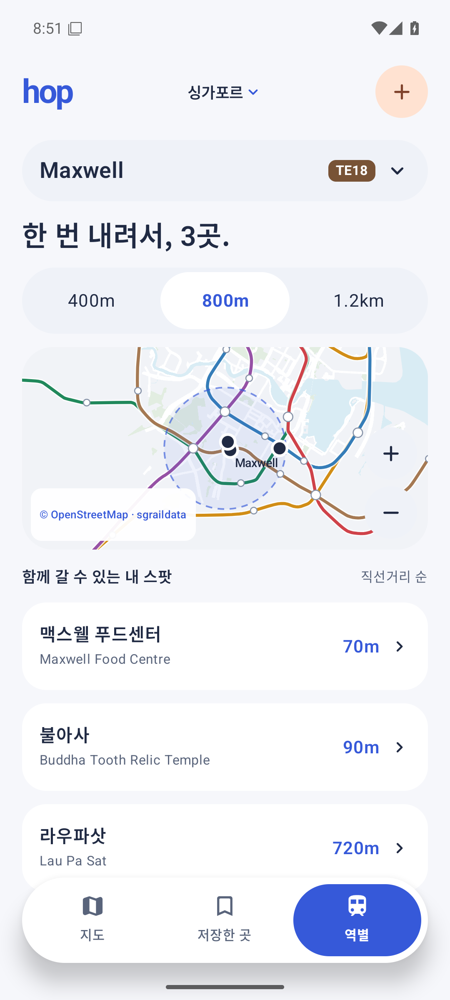
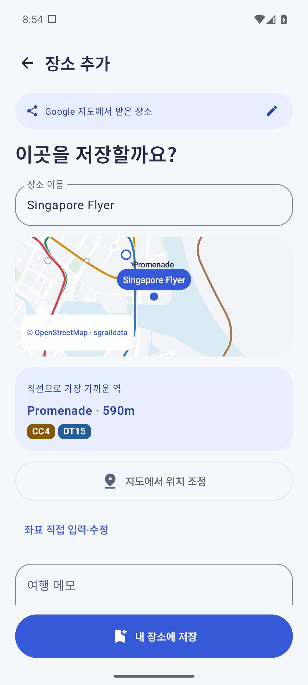

# hop — 싱가포르 MRT 여행 앱

Kotlin + Jetpack Compose로 구현한 싱가포르 여행용 Android MVP입니다. Blue Hour 테마와 플로팅 메뉴를 적용했습니다. 실제 앱 소스는 `app/`입니다.

## 설치와 실행

- **Obtainium 소스 URL:** https://github.com/jonghyunseo/hop-singapore
- Obtainium → 앱 추가 → 위 URL 입력 → 추가 → 설치. 이후 GitHub Release의 새 버전을 확인할 수 있습니다.
- **[최신 APK 다운로드](https://github.com/jonghyunseo/hop-singapore/releases/latest)** · Android 8.0(API 26) 이상.
- 앱 패키지 `app.hop.singapore`. APK는 기종별 선택이 필요 없는 단일 파일입니다.
- Android Studio에서 이 폴더를 열고 `app` 실행 구성을 선택해도 됩니다.
- 첫 실행은 싱가포르 예시 여행지 6곳으로 시작합니다. 자유롭게 수정·삭제할 수 있습니다.
- 전용 키로 서명한 release APK입니다. 스토어 배포·사용자 계정·클라우드 동기화는 포함하지 않습니다.

이전 `0.1.0-debug` APK와는 서명이 다릅니다. 개발판이 설치되어 있다면 보관할 장소·메모를 먼저 확인한 뒤 삭제하고 배포판을 설치하세요. 삭제 시 개발판의 로컬 데이터도 삭제됩니다. `0.1.1` 이후 배포판은 같은 서명 키로 업데이트합니다.

<p>  </p>

## 구현한 핵심 기능

- 6개 MRT 노선, 142개 역, 저장 장소를 지도에 표시. 확대·축소·이동·핀 선택·역 선택.
- Haversine 직선거리 기반 최근접 3개 역 비교. 선택한 역을 출발점으로 Google 도보 길찾기 열기.
- 역별 400m / 800m / 1.2km 반경 안의 저장 장소를 거리순으로 표시.
- 장소 저장·수정·메모·방문 체크·검색·방문 필터·삭제와 실행 취소.
- 원자적 파일 저장. 앱 재실행 후 장소·방문 상태·메모와 선택 설정 복원.
- Android `ACTION_SEND` 공유 수신, Google Maps 링크 붙여넣기, 장소명 검색, 좌표 입력, 지도 핀 지정.
- 공유 데이터는 검토 화면을 거쳐 저장. 링크의 지도 카메라 좌표를 장소 좌표로 오인하지 않음.
- CSV/GeoJSON 파일 선택·검토·가져오기. 중복 및 좌표 누락·싱가포르 밖의 항목을 구분.
- 라이트·다크·시스템 테마. 측정한 메뉴 높이에 따라 하단 여백을 확보하는 플로팅 메뉴.
- 내 위치는 버튼을 누를 때만 권한 요청. 백그라운드 위치 수집 없음.

## 지도와 온라인 기능

기본 간략 지도는 MRT 전역과 도심의 도로·수역·공원 벡터를 앱에 포함해 오프라인으로 표시합니다. 세부 도로 데이터는 도심 중심이며, 다른 지역은 **레이어 버튼으로 상세 지도**를 켜면 OpenStreetMap 타일을 표시합니다. 타일은 화면에 보이는 범위만 요청하고 로컬에 최소 7일 캐시합니다. 대량 다운로드나 오프라인 지역 다운로드 기능은 없습니다.

온라인 장소 검색은 기기의 Android Geocoder 제공 여부와 연결 상태에 영향을 받습니다. 좌표가 포함된 링크는 직접 해석하고 단축 링크는 허용된 Google Maps 도메인의 HTTPS 리디렉션만 따라갑니다. 좌표를 확인하지 못하면 검색 결과 선택·좌표 입력·지도 핀으로 확인해야 합니다. **Google 즐겨찾기 전체 자동 동기화는 구현하지 않습니다.**

저장된 장소·역 좌표·직선거리 계산·메모는 네트워크 없이 작동합니다. 실제 도보 경로·외부 지도·온라인 검색에는 네트워크가 필요합니다. 길찾기는 직선거리와 별도 기능입니다.

## 파일 가져오기

상단 ‘싱가포르’ → ‘CSV · GeoJSON 가져오기’. 최대 2MB, 1,000개 항목입니다. 사용자 선택 파일만 읽고 저장소 전체 권한은 요구하지 않습니다.

CSV의 예:

```csv
name,latitude,longitude,memo
Singapore Flyer,1.2894095,103.8631218,해 질 무렵
```

`title/name`, `latitude/lat`, `longitude/lon/lng`, `memo/note/comment`, `url` 헤더를 인식합니다. GeoJSON은 Point geometry와 `name` 또는 `Title`을 사용하며, Google Takeout 형태의 `Location.Business Name`도 인식합니다. 좌표가 없는 Takeout CSV의 제목만으로 임의 위치를 저장하지 않습니다. ZIP과 목록 전체 링크는 지원 범위 밖입니다.

샘플은 `samples/places.csv`, `samples/places.geojson`입니다.

## 개발

준비된 안정 버전을 재사용해 SDK 설치·빌드 도구 교체 시간을 줄였습니다. Android SDK 36, JDK 17 이상, Gradle 8.14.3, AGP 8.13.2, Kotlin 2.2.21, Compose BOM 2025.11.01, Material 3. 특정 라이브러리의 최신 버전이라는 주장은 아닙니다.

```powershell
.\gradlew.bat :app:assembleDebug
.\gradlew.bat :app:testDebugUnitTest
```

이 Windows 환경은 시스템 경로에 잘못된 따옴표가 있어 Gradle 테스트 JVM 시작을 방해했습니다. 시스템 설정을 변경하지 않고 다음 실행 옵션으로 우회했습니다.

```powershell
.\gradlew.bat '-Djava.library.path=C:\Windows\System32' :app:testDebugUnitTest
```

핵심 흐름 검수 기록: [docs/verification.md](docs/verification.md). 반복적인 전체 테스트 대신 거리·반경·공유 좌표·호스트 검증 4개와 실제 에뮬레이터의 핵심 흐름을 점검합니다. `scripts/smoke_android.py`는 테스트 전용 `hop_api36` 에뮬레이터의 초기 6개 장소 상태와 개발용 APK를 기준으로 실행하며 테스트 데이터를 추가합니다. 개인 기기를 대상으로 실행하지 마세요.

## 배포 업데이트

1. `app/build.gradle.kts`의 `versionCode`와 `versionName`을 함께 올립니다.
2. 같은 서명 키로 `scripts/build-release.ps1`을 실행합니다. 키와 암호는 저장소에 포함하지 않습니다.
3. 커밋과 `v버전` 태그를 올리고 GitHub Release에 `deliverables/hop-버전.apk`와 `.sha256` 파일을 첨부합니다.
4. Obtainium은 같은 저장소 URL에서 새 Release를 확인합니다.

Windows 배포 스크립트는 사용자 프로필의 `.android/hop-singapore-release`에서 키를 읽고, 현재 사용자에게 암호화된 DPAPI 비밀번호를 해독해 빌드 프로세스 환경 변수로만 전달합니다. 다른 빌드 환경에서는 `HOP_SIGNING_STORE_FILE`, `HOP_SIGNING_STORE_PASSWORD`, `HOP_SIGNING_KEY_ALIAS`, `HOP_SIGNING_KEY_PASSWORD`를 주입한 뒤 `:app:assembleRelease`를 실행할 수 있습니다. 기존 키를 잃으면 같은 앱을 정상 업데이트할 수 없으므로 키와 암호의 별도 안전한 백업이 필요합니다.

## 코드 위치

| 파일 | 역할 |
|---|---|
| `Domain.kt` | 거리·역 후보·반경·공유 좌표 해석 |
| `Data.kt` | 로컬 저장·ViewModel·온라인 검색·링크 확인 |
| `MapView.kt` | 지도 렌더링·카메라·제스처·타일 캐시 |
| `HopApp.kt`, `Theme.kt` | 네이티브 화면·플로팅 메뉴·테마 |
| `Imports.kt` | CSV/GeoJSON 검토 데이터 생성 |
| `MainActivity.kt` | Android 공유 수신·위치 요청 |

원본 데이터와 사용 조건은 `THIRD_PARTY_NOTICES.md`를 참고하세요. 실시간 열차·운임·출구별 접근성·여행 순서 최적화·여러 여행·계정 동기화는 후속 범위입니다.
