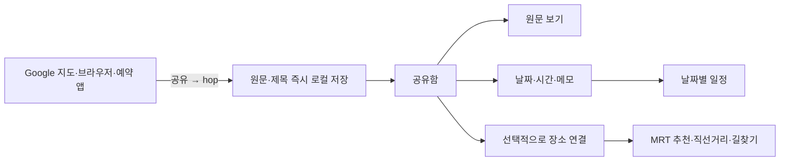

# hop 공유 중심 여행 시스템

2026-10-29 · Android / Kotlin / Jetpack Compose · 구현 버전 0.4.0

## 제품 결정

여행 준비 중 발견한 정보를 **공유 → 즉시 보관 → 원문 확인 → 필요할 때 일정/지도 연결**로 처리한다. 모든 링크를 지도 좌표로 바꾸려 하지 않는다. Google 지도 목록은 원본을 다시 열 수 있는 여행 자료이며, 개별 장소만 선택적으로 MRT와 연결한다.

사용자는 내보내기 파일을 만들거나, 화면을 캡처하거나, 좌표를 확인해야 정보를 저장하는 과정을 거절했다. 따라서 가져오기 마법사보다 Android 공유 수신을 기본 수집 경로로 둔다.

## 여행앱 벤치마크

공개된 공식 설명과 도움말을 비교했다. 경쟁 앱을 직접 설치해 사용성 실험을 했다는 뜻은 아니다.

| 앱 | 확인한 방식 | hop에 적용한 판단 |
|---|---|---|
| [Tripsy](https://tripsy.app/support/how-to-add-activities-from-the-share-extension) | 다른 앱의 공유 메뉴에서 여행 활동을 추가. 공식 예시는 iOS Google Maps | Android 공유 대상으로 hop 제공. 별도 장소 입력 화면을 강요하지 않고 원문부터 보관 |
| [TripIt](https://www.tripit.com/web/free/how-it-works) | 예약 확인 이메일을 전달하면 여행 일정으로 모음 | 숙소·예약·이동 정보와 메모를 같은 여행 보관함에 모으고 원문으로 돌아가기 쉽게 구성. 이메일 수집/자동 예약 해석은 이번 범위 아님 |
| [Wanderlog](https://help.wanderlog.com/hc/en-us/articles/5159511810843-Add-a-place-from-a-guide-to-trip-plan) | 가이드의 장소를 목록/날짜에 추가하고 나중에 대상 변경 | 먼저 모은 정보에 날짜·시간을 나중에 붙이는 점진적 정리. 날짜별 일정과 지도 장소를 연결 |

세 제품의 공통 장점은 발견한 정보와 여행 계획 사이의 입력 작업을 줄이는 것이다. hop은 로그인·백엔드 없이 기기에 저장하고, Singapore MRT 연계에 집중한다.

## 정보 구조

하단 플로팅 메뉴는 **지도 / 여행 / 역별** 세 개를 유지한다. 기존 ‘저장한 곳’은 여행의 ‘장소’로 이동하며 데이터는 유지한다.

- **여행 → 공유함:** 최신 정보, 중요 고정, 미완료 필터, 제목/내용/메모 검색.
- **여행 → 일정:** 날짜·시간 순서, 날짜 미정 묶음, 완료 체크. 모든 일정 시간은 싱가포르 현지 시간.
- **여행 → 장소:** 기존 저장 장소, 방문 상태, 가까운 역. 파일 가져오기는 보조 기능.
- **정보 상세:** 원문 보기, 일정·메모, 장소 연결/지도 보기, 중요 표시, 다시 공유, 삭제/실행 취소.

## 핵심 사용자 흐름

### 정보를 모을 때

1. 원래 앱에서 공유를 누르고 hop 선택.
2. hop이 텍스트/URL과 공유 제목을 저장하고 상세 카드를 표시. 네트워크나 좌표가 없어도 완료.
3. ‘원문 보기’로 읽거나 ‘공유한 앱으로 돌아가기’로 수집을 계속한다.
4. 같은 링크를 다시 보내면 기존 항목을 열고 일정·메모를 보존한다.

### 여행 중 꺼내 볼 때

- 예약 링크를 중요 표시해 공유함 위에 고정한다.
- 일정·메모에서 날짜, 선택적 시간, 예약번호/준비물을 추가한다.
- 일정 화면에서 날짜별로 확인하고 완료 처리한다.
- 장소 연결이 있는 항목은 지도로 이동해 최근접 MRT를 확인한다.
- Google 지도 목록은 원문으로 열어 최신 목록을 확인한다. 목록 전체가 hop 지도 핀으로 변환됐다고 표시하지 않는다.

## 데이터와 동작

`TravelItem`은 제목·원문 텍스트·URL·분류·날짜·시간·메모·중요/완료 상태·연결 장소 ID·생성 시각을 가진다. 좌표는 필수 항목이 아니다. 기존 `Place` 데이터와 연결 ID로 관계를 맺는다.

- `travel.json`: 버전 1 JSON, AtomicFile과 쓰기 잠금. 실패 시 원본 파일 유지.
- `places.json`: 기존 장소 파일을 유지. 연결된 장소가 삭제되면 다시 연결할 수 있음.
- Android ACTION_SEND: text/plain 및 text/html 공유의 EXTRA_TEXT와 제목을 읽음. 이미지·PDF 파일 첨부나 OCR은 이번 범위 아님.
- 수신 즉시 저장. 앱 서버로 원문을 전송하거나 링크를 백그라운드에서 긁지 않음.
- 링크는 http/https만 열며 사용자 정보가 포함된 URL/실행 스킴 제외.
- 중복 키는 원본 경로·의미 있는 쿼리·프래그먼트를 유지하고 일반 추적 파라미터만 제외.
- 원문은 Android Custom Tabs로 열어 브라우저 로그인 상태를 사용할 수 있게 함. 제공 브라우저/원본 서비스에 따라 외부 앱으로 이동할 수 있음.
- 예약 정보는 사용자가 날짜·시간을 확인해 입력. 본문에서 추측해 자동 확정하지 않음.

## 디자인 시스템

사용 스킬: [ui-ux-pro-max](C:/Users/jongh/.codex/skills/ui-ux-pro-max/SKILL.md).

기존 Blue Hour 색상·둥근 표면·플로팅 메뉴를 유지한다. `travel planner mobile collection --design-system`은 웹 스토리텔링/Aurora를 반환해 앱 구조에 적용하지 않았다. `Material 3 Expressive --domain style`로 다시 검색해 `material-you-md3-mobile` 결과를 확인했고, 테마 토큰·48dp 터치·캡슐 버튼·단계별 정보 공개를 채택했다. `state restoration bottom sheet --stack jetpack-compose`는 결과 0개였으며 `remember state` 재검색에서 UI 상태/업무 상태 분리와 rememberSaveable 지침을 확인했다. 현재 프로젝트의 라이브러리를 스킬 DB의 버전 주장에 맞춰 일괄 교체하지 않았다.

자료가 들어온 뒤에는 큰 시작 안내 카드를 숨기고 목록을 먼저 보여준다. 화면 제목 22–25sp, 카드 제목 17sp, 본문 15–16sp, 메타 12–13sp. 중요도는 색뿐 아니라 아이콘/문구로 표시한다. 날짜·분류 버튼은 줄바꿈하고 편집 화면은 키보드/안전 영역에 맞춰 스크롤한다. 업무 상태는 ViewModel, 저장한 여행 정보는 파일, 일시적인 화면 선택은 Compose 상태로 분리한다.

## 범위와 후속 확장

이번 버전은 단일 싱가포르 여행 보관함이다. Google 계정 동기화, Google 목록 전체 자동 추출, 이메일 계정 읽기, 예약 자동 분석, 파일 첨부, 동행자 클라우드 협업, 여러 여행 프로젝트는 구현했다고 주장하지 않는다. 필요가 확인되면 여행 ID와 첨부 메타데이터를 추가할 수 있는 구조다.

외부 원문은 인터넷/로그인이 필요할 수 있다. 저장한 제목·메모·일정은 오프라인으로 볼 수 있다. MRT 거리와 실제 길찾기 범위는 기존 앱과 같다.
